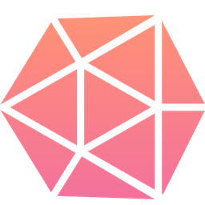

<p align="center">
  
</p>

<h1 align="center">Icosahedron HUB</h1>

<p align="center">
  <b>Your Navidrome / Subsonic music, on every device, in step.</b><br>
  Desktop · Web · iPhone · Android · Android Auto · Android TV — with an optional sync server that ties them together.
</p>

<p align="center">
  <a href="https://github.com/raudraido/Icosahedron/releases/latest"></a>
  <a href="https://github.com/raudraido/Icosahedron/pkgs/container/icosahedron-server"></a>
  <a href="https://github.com/raudraido/Icosahedron/actions"></a>
  <a href="LICENSE"></a>
</p>

---

**Icosahedron HUB** is the project as a whole: a family of players for your own [Navidrome](https://www.navidrome.org/) / Subsonic server and a small sync server (the *web engine*). The players are called **Icosahedron**. Start a song on one device and continue on another, or control one device from another.

```
  Desktop        Web app       iOS app      Android phone     Android TV
 (Electron      (same UI,    (SwiftUI)    (Kotlin, with      (Kotlin,
  + Rust)       in a browser)               Android Auto)     for the TV)
     │              │             │              │                │
     └──────────────┴───────┬─────┴──────────────┴────────────────┘
                            ▼
                 ┌─────────────────────┐      optional: adds sync and remote control,
                 │   Web engine        │      secure sign-in, the web app, shared BPM,
                 │   (Docker, Node)    │      Last.fm and the plugin page
                 └──────────┬──────────┘
                            ▼
                    Navidrome / Subsonic
```

**You do not need the web engine to use the apps.** They talk to Navidrome directly. The engine adds sync between devices, the web app, secure sign-in, a shared BPM store and Last.fm scrobbling across all your devices.

## Download

Every product has its own version, its own release and its own changelog. Pick yours:

| Product | For | Get it | Install guide | Changelog |
|---|---|---|---|---|
| **Desktop app** | Linux (AppImage, `.deb`), Windows | [Releases](https://github.com/raudraido/Icosahedron/releases?q=%22Desktop+app%22) | [desktop.md](docs/desktop.md) | [CHANGELOG.md](CHANGELOG.md) |
| **Web engine + web app** | Docker (amd64, arm64) | `ghcr.io/raudraido/icosahedron-server` | [deploy-server.md](docs/deploy-server.md) | [apps/server](apps/server/CHANGELOG.md) |
| **iOS app** | iPhone, iPad | unsigned `.ipa` in [Releases](https://github.com/raudraido/Icosahedron/releases?q=%22iOS+app%22), signed with SideStore / AltStore | [ios.md](docs/ios.md) | [apps/ios](apps/ios/CHANGELOG.md) |
| **Android phone app** | phones, tablets, Android Auto | `.apk` in [Releases](https://github.com/raudraido/Icosahedron/releases?q=%22Android+phone%22) | [android.md](docs/android.md) | [apps/android](apps/android/CHANGELOG.md) |
| **Android TV app** | Google TV, Android TV | `.apk` in [Releases](https://github.com/raudraido/Icosahedron/releases?q=%22Android+TV%22) | [android-tv.md](docs/android-tv.md) | [apps/android-tv](apps/android-tv/CHANGELOG.md) |

**Channels.** *Stable* releases are what you want. *Beta* releases (marked **Pre-release**, version `X.Y.Z-beta.N`, Docker tag `:beta`) come first, for people who want to try a change early and report what breaks. *Edge* is every build of `master` (Docker tag `:edge`). Details: [docs/releasing.md](docs/releasing.md). Which versions work together: [docs/compatibility.md](docs/compatibility.md) — rule of thumb, **update the server first**.

## What it can do

- **Play everywhere, keep it in step:** one queue and position follow you; the *Devices* list shows every device of your account with what it plays; *Send* and *Play here* move playback, and any device can control another.
- **Secure sign-in for a server on the internet:** a new device has to be approved by a device that is already signed in, so a password alone gets nobody in ([docs/secure-sign-in.md](docs/secure-sign-in.md)).
- **Gapless playback** (desktop, iOS, Android), 10-band equalizer, **playback speed** 0.5×–2× with the pitch kept, lyrics (timed, from the server or LRCLIB), **BPM**, favorites, ratings, playlists, share links.
- **Offline:** an audio cache and *Download* for songs, albums and playlists (iOS, Android); *Download* on the desktop too, and the desktop app opens without the server when it has downloads. The web app has no offline music.
- **In the car:** Android Auto from the Android phone app; CarPlay is a skeleton that has not been run yet ([docs/carplay.md](docs/carplay.md)). The car's own Now Playing screen works from the iOS app.
- **On the TV:** Android TV / Google TV, signed in with Quick Connect.
- **Also:** casting to Chromecast / AirPlay 2 / DLNA (desktop), Last.fm scrobbling, upcoming concerts for the artist (Ticketmaster), a settings page for Navidrome's plugins.

## Quick start

**Run the web engine** (Docker):

```yaml
# docker-compose.yml
services:
  icosahedron:
    image: ghcr.io/raudraido/icosahedron-server:latest
    restart: unless-stopped
    environment:
      NAVIDROME_URL: http://navidrome:4533     # your Navidrome, reachable from the container
    volumes:
      - ./data:/data
    ports:
      - "8080:8080"                            # put a TLS reverse proxy in front (see docs)
```

Open `http://<host>:8080`, sign in with your Navidrome account. Details, environment variables and reverse-proxy notes: [docs/deploy-server.md](docs/deploy-server.md).

**Desktop app:** download a build from the [Releases](https://github.com/raudraido/Icosahedron/releases) page (AppImage / `.deb` for Linux, `.exe` for Windows), or build it yourself — see below. To sync, press the *devices* button next to the cast button and enter your engine's address.

**Android phone app:** open `Icosahedron-Android-<version>.apk` from a release on the phone, see [docs/android.md](docs/android.md). **Android TV app:** sideload the APK from a release, see [docs/android-tv.md](docs/android-tv.md).

**iOS app:** download the unsigned `.ipa` from a release and sign it for your device with AltStore, SideStore, Sideloadly or iloader — see [docs/ios.md](docs/ios.md).

## Documentation

Start at the [documentation index](docs/README.md). The most useful pages:

- How the parts fit together: [architecture](docs/architecture.md) · the sync wire protocol: [sync-protocol](docs/sync-protocol.md)
- Running the server: [deploy-server](docs/deploy-server.md) · signing in safely from the internet: [secure-sign-in](docs/secure-sign-in.md)
- Releases, beta tags and versions: [releasing](docs/releasing.md) · [compatibility](docs/compatibility.md)
- Building and contributing: [contributing](docs/contributing.md)

## Project status

Icosahedron is built and used daily by its author, and released in the open. Expect fast changes: the version numbers are `0.x`, and a *minor* bump can add features that need a newer server. The Android phone app is a pre-release until it is on Google Play; CarPlay is a skeleton that has not been run yet. Found a bug or have an idea? [Open an issue](https://github.com/raudraido/Icosahedron/issues/new/choose) — and say which product and version.

## Contributing

Pull requests are welcome; start with [CONTRIBUTING.md](CONTRIBUTING.md). Security problems: please read [SECURITY.md](SECURITY.md) first and do not open a public issue.

## License

GPLv3 — see [LICENSE](LICENSE) and [NOTICE.md](NOTICE.md). Third-party credits: [CREDITS.md](CREDITS.md).
