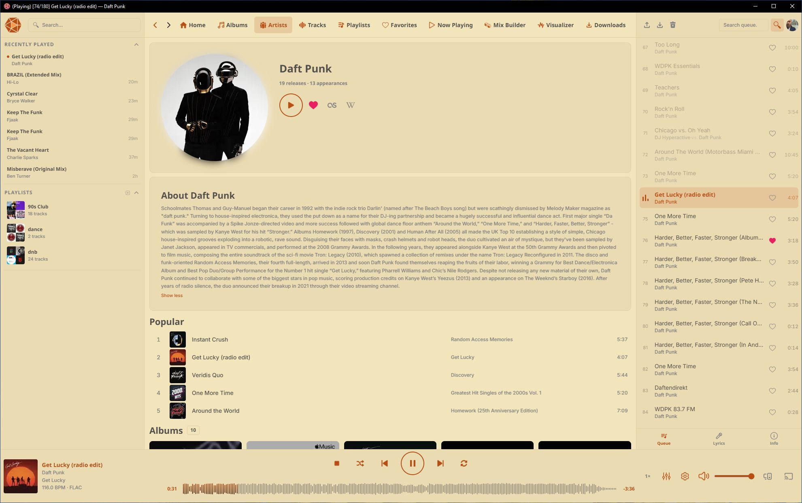
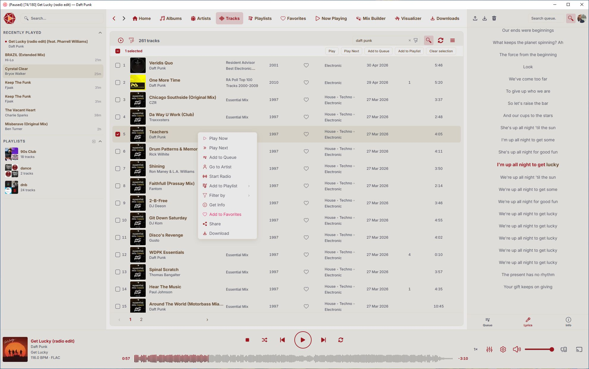
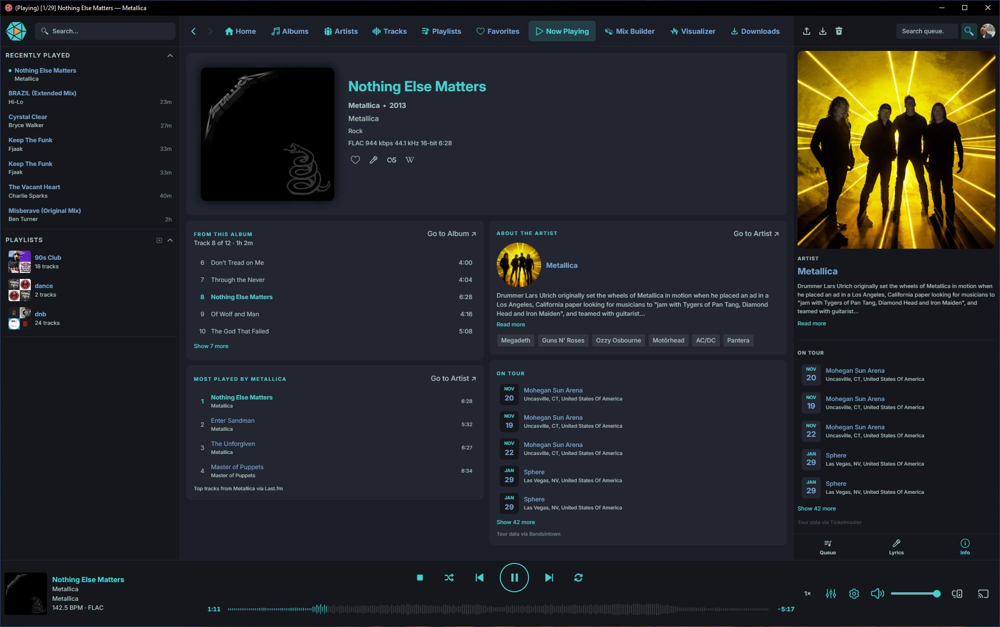
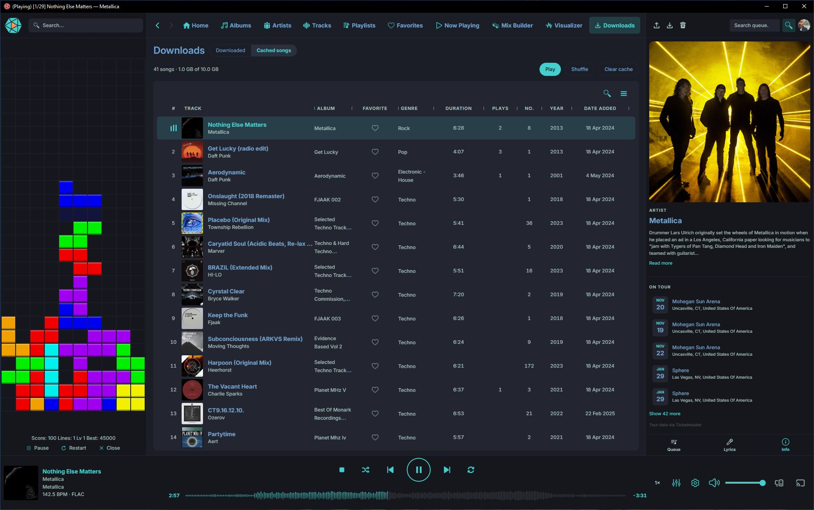

# Desktop app

Electron + React (the UI in `src/`) with a native Rust audio engine (`native/audio-engine`): gapless playback, 10-band equalizer, BPM analysis, Chromecast / AirPlay 2 / DLNA casting.

## Screenshots

<table>
<tr>
<td></td>
<td></td>
</tr>
<tr>
<td></td>
<td></td>
</tr>
</table>

<sub>Artist page · songs with the right-click menu · Now Playing · Downloads → Cached songs. The colours are three of the built-in and custom themes.</sub>

## What it does

- Gapless playback with a native Rust engine, a 10-band equalizer and **playback speed** 0.5×–2× (pitch follows the speed on the desktop; the web app keeps the pitch).
- **Device control and jukebox:** choose another device with the devices button and control it, or queue music on it with *Add to Device Queue*. *Settings → Sync Server → Jukebox* shows the address, a QR code and the steps for turning a spare screen into a player ([jukebox.md](jukebox.md)).
- **Casting** to Chromecast, AirPlay 2 and DLNA devices (Windows and Linux).
- **BPM** analysis (with a correction for drum & bass, which otherwise reads half speed), kept in the shared BPM store.
- **One click plays** a song, tick boxes select several; synced lyrics; Last.fm.
- **Downloads:** songs, albums and playlists kept on the computer (right-click → Download), played without the server; a Downloads tab, Settings → Downloads, and the app opens offline on that tab when the server cannot be reached. **Played songs are cached** too (Settings → Downloads → Cache: limit, clear), oldest first out; downloads stay. Downloads → **Cached songs** lists them (play, *Download* to keep one for good, remove).
- **On Tour:** upcoming concerts of the artist (Ticketmaster).
- **Settings → Navidrome plugins** for a Navidrome administrator: what is installed, what uses it, switches and settings.
- Sync, remote control and **secure sign-in** with the other devices ([architecture.md](architecture.md)).

## Install

Download from the [Releases](https://github.com/raudraido/Icosahedron/releases) page:

- Linux: `.AppImage` or `.deb`
- Windows: `.exe` installer

The app checks GitHub Releases for a newer version and offers to download the installer (no code signing, so Windows may warn).

## Build from source

Requirements: Node 22, a Rust toolchain (`cargo`/`rustc`), and on Linux the ALSA development headers (`libasound2-dev`).

```bash
npm install          # also builds native/audio-engine
npm run dev          # development, electron-vite dev server
npm run build        # typecheck + build
npm run dist         # + electron-builder → dist/
```

`npm run build:native` rebuilds only the audio engine. The CI workflow `.github/workflows/build.yml` builds Linux and Windows packages on their own runners.

## Sync with your other devices

Optional; nothing changes until you set it up. You need a running Icosahedron Server ([deploy-server.md](deploy-server.md)).

1. Press the **devices** button next to the cast button.
2. Enter the engine's address, for example `https://music.example.com`.
3. The popover lists your devices. **Send** / **Play here** move playback, and the playing device can be controlled from the popover.

What is shared and how: [architecture.md](architecture.md), [sync-protocol.md](sync-protocol.md).

- **Shared preferences** (theme, equalizer, toggles, orderings, sort choices) follow you between devices. A change from another device reloads the window, or shows a toast while music plays.
- **BPM** detected by the native analyzer is uploaded to the engine, and values from other devices are read. Existing local BPM values are uploaded once. A manual correction wins.

Last.fm on the desktop is its own local connection (separate from the engine's), so connecting both places can count a play twice.

## Where things are

| Path | What |
|---|---|
| `src/` | The React UI (also the web app) |
| `src/platform/` | Platform layer between the UI and Electron / browser |
| `src/lib/subsonic/` | Subsonic client, shared with the browser |
| `electron/main/` | Main process: Subsonic commands, audio engine client, casting, credentials, updater |
| `electron/preload/` | The `electronAPI` bridge |
| `native/audio-engine/` | Rust (napi-rs) audio engine |
